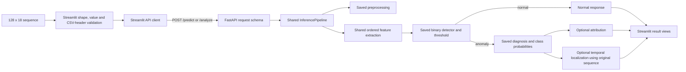

# Integration and End-to-End Test Report

**Run date:** 2026-11-22  
**Environment:** Windows, Python 3.13.3; exact dependency lock from `uv.lock`  
**Automated result:** 136 passed, 0 failed

## Scope

The verification covered the FastAPI endpoints, saved-artifact inference,
strict KPI CSV parsing, secret-safe API client behavior, all nine Streamlit
pages, the populated Temporal Localization workflow, and deployment settings.
The final locked-environment smoke check used the locally saved TelecomTS
models and held-out processed records rather than test doubles.

The run used pinned TelecomTS revision
`1b3a88a440f4922edfcd1e230e42c003c0e13bdf`. It did not fit models or make
new evaluation claims.

## API verification

| Endpoint / behavior | Result |
|---|---|
| `GET /health` | HTTP 200 confirms liveness only; response separately reports `prediction_ready`, readiness status, and a reason when unready. Required detection artifacts are loaded and their feature/metadata contracts checked. |
| `POST /predict` | Finite 128-by-18 validation, optional exact KPI-name order, saved preprocessing/features/detector/threshold, and binary response verified. |
| `POST /analyze` | Conditional diagnosis with probabilities, model versions, optional attribution and temporal interval verified. Normal samples skip diagnosis. |
| `GET /model-info` | Model versions, threshold, dataset revision, feature configuration and category list verified. |
| Missing/corrupt required artifacts | Liveness remains HTTP 200 while readiness is false; prediction reports an explicit 503/500 error, without a fallback result. |
| CORS and OpenAPI | Preflight and schema documentation tests pass. |
| Logging | Prediction/analysis requests and rejected samples/readiness failures are logged through configured application logging. |
| Production authentication | `/predict`, `/analyze`, and `/model-info` reject absent keys and accept the configured `X-API-Key`; `/health` remains public. |
| Production configuration | Startup rejects a missing/weak API key, wildcard/missing CORS, and non-HTTPS production origins. |
| Hosted binding | `CL5G_API_HOST` and host-provided `PORT` are used by the Uvicorn startup path. |

`prediction_ready` means required binary-prediction artifacts are present,
loadable, and consistent with metadata and model feature order. Diagnosis,
attribution and localization are optional and do not gate binary readiness.
The dashboard rejects non-HTTPS external backend URLs, and the API client only
sends the configured key to the exact `CL5G_API_BASE_URL`; an editable URL
cannot redirect the key to another host.

## Dashboard and input verification

All nine existing pages rendered in Streamlit `AppTest`:

1. Network Overview
2. Dataset Exploration
3. KPI Monitoring
4. Anomaly Detection
5. Anomaly Diagnosis
6. KPI Attribution
7. Temporal Localization
8. Model Evaluation
9. About the Project

Dataset exploration and historical chart rendering were exercised with
test-only tabular data. Evaluation metrics remain unavailable unless actual and
predicted labels are supplied. Prediction and analysis are submitted through
the FastAPI API client; the dashboard does not implement a second model path.

Inference CSV uploads must have exactly the canonical 18 KPI header names in
the trained order. Reordered, renamed or missing channels are rejected before
submission. Supported protocol strings and categorical nulls are retained;
numeric values must be finite. Unlabeled JSON arrays remain positional and are
interpreted in canonical KPI order. The original sequence is stored separately
from the features and is sent through analysis for temporal localization.

The Temporal Localization regression test populates both the sequence and
analysis state, selects that page, and verifies the channel selector, plot and
interval render without an `UnboundLocalError`.

## Live saved-artifact integration

A previous application integration run started a temporary local Uvicorn
server with the configured artifacts. The standard Streamlit API client sent
HTTP requests to that service; the dashboard `AppTest` then requested complete
analysis through the same HTTP client and rendered the response.

The final deployment-security recheck used FastAPI `TestClient` with the exact
locked environment, production security settings, actual saved artifacts, and
real held-out TelecomTS sequences. It did not substitute test-double models.

| Flow | Outcome |
|---|---|
| Health and model information | `alive`, `ready`; 250 configured ordered features; model-info rejected a missing key and succeeded with the configured key. |
| Real anomalous TelecomTS sample through `/predict` | `anomaly`. |
| Same anomalous sample through `/analyze` | Diagnosis returned (`Jamming` for the selected sample), 11 class probabilities, KPI attribution and temporal localization. |
| Real normal TelecomTS sample through `/analyze` | `normal`; diagnosis was not run and anomaly type remained null. |
| Streamlit Overview → Anomaly Diagnosis → KPI Attribution → Temporal Localization | Rendered with the response from the live API and actual artifacts; no Streamlit exception. |
| Same anomalous record with attribution/localization disabled | HTTP 200; both optional response fields explicitly null. |

This is an integration smoke check on selected real records, not an estimate of
generalization or model quality. Model evaluation results are documented
separately in the revision-specific reports and README.

## Automated tests and static checks

`python -m pytest`: **136 passed** in the exact `uv.lock` environment. Coverage includes request validation,
named KPI-order rejection, readiness with missing and corrupt artifacts,
normal/anomalous paths, optional-module absence, API errors/CORS/OpenAPI,
API-key enforcement and production configuration, HTTPS URL checks, secret
destination protection, CSV-order and categorical checks, Streamlit page
rendering, and the temporal page regression case.

`uv lock --check`: passed. `uv pip check --python .venv\Scripts\python.exe`:
all locked packages compatible. `python -m compileall -q src backend frontend
tests`: passed.

## Verification notes

- The AppTest report is the documented UI verification; no browser screenshots
  were captured.
- The Render blueprint and Streamlit Community Cloud configuration were
  prepared but no external service was deployed. Hosted secrets, artifact
  transfer, service health, and public HTTPS traffic have not been verified.
- Model files are ignored by Git and must be securely provisioned on the
  backend's persistent artifact volume before prediction readiness is true.
- The full application remains research software and is not connected to a live
  5G network.
- The temporal model remains experimental as described in the README.
- Model and dataset artifacts are local generated files; reproducibility
  depends on the pinned TelecomTS revision and the saved artifact inventory.

## Flow

